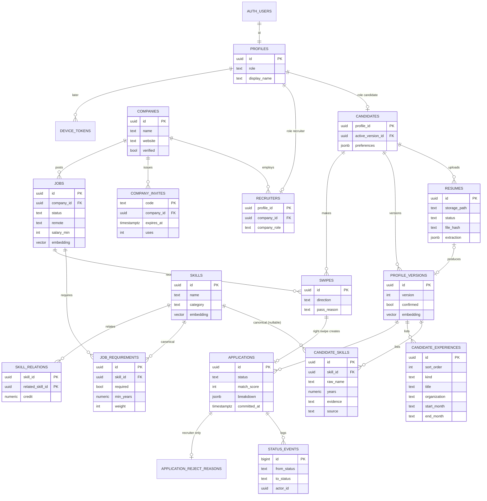

# ResuRhombus: Database Schema

**Companion to:** [schema.sql](schema.sql) (full reference DDL) · [PRD.md](PRD.md) §9 · [TASKS.md](TASKS.md)

This is the agreed target schema for Supabase Postgres.

- **Owner:** Person A owns it and turns `schema.sql` into migrations.
  - **PL-04:** identity and companies
  - **PL-05:** candidates and skills
  - **PL-06:** jobs and the apply/review loop
- **Changes:** Changing a table, column, or function signature is an API contract change. Post it in the team chat and update this file, `schema.sql`, and `API_CONTRACT.md` in the same PR.

**Conventions**
- Primary keys are `uuid default gen_random_uuid()`. The exceptions are `profiles.id`, which equals `auth.users.id`, and the append-only logs, which use `bigint identity`.
- Every table has **RLS enabled**. Clients use the anon key, so a table without RLS would be public.
- Embeddings are `vector(1536)` from `gemini-embedding-001` (1536-dim output, PRD v0.5) and are always stored with an `embedding_model` column (PRD §9.3).
- Demo data rows have `is_seed = true`, so they can be removed in bulk.
- `created_at` and `updated_at` are `timestamptz`. `updated_at` is maintained by the `touch_updated_at()` trigger.

---

## 1. Entity diagram



---

## 2. Tables

### Identity & companies (PL-04)

| Table | Purpose | Key columns & rules |
|---|---|---|
| `profiles` | One row per user. Created by the `handle_new_user()` trigger on `auth.users`. | `id` = `auth.users.id`. `role app_role` (`candidate`/`recruiter`) is null only for Google users who haven't picked yet. `terms_accepted_at`. |
| `companies` | A recruiter workspace | `name` (1–120 chars), `website`, `logo_path` (public `company-logos` bucket), `verified` (email domain matches website, PL-26) |
| `recruiters` | Links a recruiter to exactly one company | PK `profile_id`, so one company per recruiter. `company_role` is `owner` or `member`. |
| `company_invites` | Codes teammates use to join | `code` is 8 characters from an unambiguous alphabet (no I, L, O, 0, 1). Also `expires_at`, `revoked_at`, `max_uses`, and `uses`. |
| `app_config` | Single-row settings | `daily_apply_cap` (25), `scoring_version` ('v1'), `undo_seconds` (5), `reject_undo_seconds` (10) |

### Candidates & skills (PL-05)

| Table | Purpose | Key columns & rules |
|---|---|---|
| `skills` | Canonical taxonomy, seeded (AI-01) | Unique `name`, `category`, `aliases text[]` (GIN index), `embedding` (HNSW cosine index) |
| `skill_relations` | Curated partial credit between related skills | `(skill_id, related_skill_id)` with `credit` between 0 and 1, e.g. MySQL → PostgreSQL = 0.6 |
| `candidates` | Candidate-specific data | `active_version_id` points to the confirmed profile used for matching. `preferences jsonb` holds the hard filters (shape below). `discoverable` is for Phase 2. |
| `resumes` | One row per stored file (seed data and uploads before October 22, 2026; `parse-resume` no longer writes here) | `storage_path` = `{uid}/{uuid}.pdf\|docx` inside the `resumes` bucket. `file_hash` (sha256, extraction cache). `status` is UPLOADED → PARSING_LAYOUT → EXTRACTING → NORMALIZING → READY / FAILED. `failure_reason`. `extraction` holds the validated LLM JSON. |
| `profile_versions` | Versioned candidate profile | Unique `(candidate_id, version)`. `source` is `resume` or `manual`. `confirmed` is required before swiping. `total_years`, `education`, `embedding`. `resume_id` is null for in-memory parses. `schema_version` and `llm_model` record which extraction produced an AI draft. |
| `candidate_skills` | Skills in one profile version | `skill_id` is null when unmapped (kept but not scored). `raw_name`. `years` is null when the skill is only listed, not evidenced. `evidence` is a quote from the resume. `source` is `ai` or `user`. Unique per version and skill. |
| `candidate_experiences` | Experience entries read from a resume, per profile version | `sort_order` (0 = most recent, unique per version), `kind` (`experience_kind`), `title` (1–200 chars), `organization` (null or 1–200), `start_month` (`YYYY-MM` or `YYYY`), `end_month` (same, or `present`), `highlights text[]` (≤ 6, verbatim), `skills_used text[]`, `evidence`. Written only by `save_parsed_profile` and copied by `create_review_draft`. |

### Jobs & the loop (PL-06)

| Table | Purpose | Key columns & rules |
|---|---|---|
| `jobs` | A posting | `raw_description` (≤ 20k chars), `parse_status`, `status` (DRAFT → OPEN ⇄ PAUSED → CLOSED), the hard-filter fields (`location`, `remote`, `job_type`, `sponsorship`, `salary_min`, `salary_max`), `embedding`, `published_at`, `expires_at` (+60 days), `rescored_at` |
| `job_requirements` | Scored requirements | `skill_id` is required, because only mapped skills can be scored. Also `required`, `min_years`, `weight` (1–3), `evidence`. Unique `(job_id, skill_id)`. Max 15 per job and 8 required, enforced in `save_requirements()`. |
| `swipes` | Every left or right decision | Unique `(candidate_id, job_id)`, so a job can't be swiped twice. `pass_reason` is only allowed on left swipes. |
| `applications` | Created by a right swipe | `match_score` (0–100), `breakdown` (radar data), `scoring_version`, and `profile_version_id` (a snapshot from apply time). `committed_at` = now + 5 s, and recruiters can't see the row before then. Also `status`, `previous_status` (for reject undo), `advanced_by`, `interview_note`, and `anonymized`. |
| `application_reject_reasons` | Internal reject reason | Kept in a separate, recruiter-only table so a candidate can never read it |
| `status_events` | Audit log of every status change | `from_status`, `to_status`, `actor_id` (null = system) |
| `llm_usage` | Token and cost log for the daily budget | `function_name`, `provider`, `model`, token counts, `latency_ms` |
| `device_tokens` | *(Later, PL-22)* FCM push tokens | PK `(user_id, token)`, `platform` |

### Views (`security_invoker = true`, so the caller's RLS applies)

| View | Used by | Returns |
|---|---|---|
| `company_jobs_overview` | Recruiter jobs list (US-38) | Each job plus `new_count` and `total_count` (committed applications only) |
| `my_applications` | Candidate pipeline (US-25) | Each application plus `job_title`, `company_name`, `company_verified`. Excludes recruiter-only fields. |

---

## 3. Enum types

| Type | Values |
|---|---|
| `app_role` | candidate, recruiter |
| `company_role` | owner, member |
| `resume_status` | UPLOADED, PARSING_LAYOUT, EXTRACTING, NORMALIZING, READY, FAILED |
| `parse_status` | PENDING, READY, FAILED |
| `profile_source` | resume, manual |
| `experience_kind` | job, internship, research, project, volunteer, other |
| `skill_source` | ai, user |
| `job_status` | DRAFT, OPEN, PAUSED, CLOSED |
| `remote_type` | onsite, hybrid, remote |
| `job_type` | full_time, part_time, contract, internship |
| `swipe_direction` | left, right |
| `pass_reason` | location, salary, stack, seniority, company |
| `application_status` | APPLIED, UNDER_REVIEW, INTERVIEW_REQUESTED, NOT_SELECTED, WITHDRAWN, JOB_CLOSED |

**Allowed status transitions:** this is the PRD §5.4 state machine. It's enforced in the RPCs, never by direct client updates.

| From | To | Done by |
|---|---|---|
| APPLIED | UNDER_REVIEW | `open_application` (recruiter opens detail) |
| APPLIED, UNDER_REVIEW | INTERVIEW_REQUESTED | `advance` |
| APPLIED, UNDER_REVIEW, INTERVIEW_REQUESTED | NOT_SELECTED | `reject` |
| NOT_SELECTED | `previous_status` | `undo_reject` (within 10 s) |
| APPLIED, UNDER_REVIEW, INTERVIEW_REQUESTED | WITHDRAWN | `withdraw` (candidate) |
| any non-terminal | JOB_CLOSED | `set_job_status(CLOSED)` or the daily expiry job |

---

## 4. Row-Level Security summary

Helper: `public.current_app_role()` is a `security definer` function that returns the caller's `profiles.role`. "Own company" means `company_id = (select company_id from recruiters where profile_id = auth.uid())`.

| Table | Candidate | Recruiter | Notes |
|---|---|---|---|
| `profiles` | select/update own | select/update own | `role` can't be changed by update. Use `set_initial_role` when it's null. |
| `companies` | select all | select all; update own if `owner` | Insert only via `create_company` |
| `recruiters` | — | select rows of own company | Insert only via `create_company` / `join_company` |
| `company_invites` | — | select own company (owner) | Insert, update, and use only via RPCs |
| `app_config`, `skills`, `skill_relations` | select | select | Written only by migrations and the seed |
| `candidates` | select/update own | **none** | Recruiters never read candidate rows directly |
| `resumes` | select/insert own | **none** | Status is updated by Edge Functions (service role) |
| `profile_versions`, `candidate_skills`, `candidate_experiences` | select own. Edit via `confirm_profile`. | **none** | Blind board data comes only from `get_board` / `get_candidate_detail` |
| `jobs` | select where `status = 'OPEN'` **or** they have an application to it | select/insert/update own company; delete only DRAFT via `delete_draft_job` | The second candidate rule keeps closed jobs visible in their pipeline |
| `job_requirements` | select for jobs they can see | CRUD on own company's jobs (via `save_requirements`) | |
| `swipes` | select own. Insert via `swipe`. | none | |
| `applications` | select own (through `my_applications`) | select own company's jobs where `committed_at <= now()` | All status changes go through RPCs |
| `application_reject_reasons` | **none** | select/insert own company | |
| `status_events` | select for own applications | select for own company's applications | Inserted by RPCs only |
| `llm_usage` | none | none | Service role only |
| `device_tokens` | CRUD own | CRUD own | Later |

**Storage buckets**

| Bucket | Public? | Policy |
|---|---|---|
| `resumes` | private, 5 MB, PDF/DOCX only | Owner can read and write `resumes/{auth.uid()}/*`. Recruiters have **no** policy and only get 10-minute signed URLs from the `resume-url` function after advancing. |
| `company-logos` | public read | Write only by owners of that company (`company-logos/{company_id}/*`) |

**Realtime publication:** `resumes` (parse progress), `applications` (pipeline and board), `jobs` (parse_status). RLS applies to Realtime too.

---

## 5. Functions (the API surface)

All are `security definer` with `set search_path = public`, and each checks the caller's role and ownership itself. Exact parameters, example responses, and error codes go in `docs/API_CONTRACT.md` (PL-27).

### Postgres RPCs (`supabase.rpc(...)`)

| Function | Caller | Owner | Purpose |
|---|---|---|---|
| `current_app_role() → app_role` | policies | A | Role lookup helper |
| `set_initial_role(p_role)` | new Google user | A | Sets the role only while it is null |
| `create_company(p_name, p_website) → companies` | recruiter | A | Creates a company and makes the caller `owner`. Computes `verified`. |
| `create_invite(p_expires_in_days = 7) → text` | owner | A | Returns a new code |
| `revoke_invite(p_code)` | owner | A | |
| `join_company(p_code) → companies` | recruiter | A | Errors: `invalid_invite`, `already_in_company` |
| `confirm_profile(p_version_id, p_skills jsonb)` | candidate | A | Saves edits, confirms the version, and sets `active_version_id` |
| `create_manual_profile() → profile_versions` | candidate | A | Fallback when parsing fails |
| `create_review_draft() → profile_versions` | candidate | B | Copies the active version (skills with provenance, experiences, totals) into a new draft for editing. Without an active version it is `create_manual_profile()`. Error: `not_candidate` |
| `save_parsed_profile(p_candidate_id, p_schema_version, p_llm_model, p_total_years, p_education, p_skills, p_experiences) → {profile_version_id, version}` | `parse-resume` (service role) | B | Next draft version, merged skills, and experiences in one transaction. Error: `not_candidate` |
| `save_preferences(p_prefs jsonb)` | candidate | A | Validates the shape (§6) |
| `swipe(p_job_id, p_direction, p_reason = null) → {swipe_id, application_id, committed_at}` | candidate | A | Error: `daily_cap_reached`, `profile_not_confirmed`, `job_not_open` |
| `undo_swipe(p_swipe_id)` | candidate | A | Error: `undo_window_expired` |
| `set_pass_reason(p_swipe_id, p_reason)` | candidate | A | |
| `withdraw(p_application_id)` | candidate | A | |
| `get_application_contact(p_application_id) → {name, email, note}` | candidate | A | Only when the status is INTERVIEW_REQUESTED |
| `save_requirements(p_job_id, p_requirements jsonb)` | recruiter | A | Enforces 15 total / 8 required, recomputes the job embedding, and re-scores if the job is live (AI-18) |
| `set_job_status(p_job_id, p_status)` | recruiter | A | Validates the lifecycle and cascades JOB_CLOSED |
| `delete_draft_job(p_job_id)` | recruiter | A | Deletes a DRAFT job and its requirements. Errors: `not_company_recruiter`, `job_not_found`, `job_not_draft` |
| `get_board(p_job_id, p_filters jsonb = '{}', p_limit = 50, p_offset = 0) → jsonb[]` | recruiter | A | Returns **blind** tiles, sorted by score |
| `get_candidate_detail(p_application_id) → jsonb` | recruiter | A | Blind until INTERVIEW_REQUESTED |
| `open_application(p_application_id)` | recruiter | A | APPLIED → UNDER_REVIEW (idempotent) |
| `advance(p_application_id, p_note = null)` | recruiter | A | → INTERVIEW_REQUESTED |
| `reject(p_application_id, p_reason = null)` / `undo_reject(p_application_id)` | recruiter | A | Undo works for 10 s |
| `get_interview_list(p_job_id = null) → jsonb[]` | recruiter | A | Advanced candidates, with identity |
| `match_skills(p_embedding vector, p_threshold = 0.89, p_k = 3)` | Edge Functions | B | Nearest canonical skills |
| `compute_match(p_profile_version_id, p_job_id) → {score, breakdown}` | other RPCs | B | PRD §8.4 formula |
| `get_feed(p_limit = 20, p_cursor text = null) → {cards jsonb[], next_cursor}` | candidate | B | Hard filters, then vector prefilter, then score, then Feed Rank |
| `register_device(p_token, p_platform)` | any | A | *(Later)* |

### Edge Functions (`supabase.functions.invoke(...)`)

| Function | Caller | Owner | Purpose |
|---|---|---|---|
| `parse-resume` multipart `file` | candidate | B | Reads the file in memory (never stored): text extraction (Gemini OCR for scans) → sanitize → extract → verify → repair (≤ 1 round) → normalize → `save_parsed_profile`. Streams progress with `Accept: text/event-stream` (API_CONTRACT §2) |
| `parse-job` `{job_id}` | recruiter | B | JD → draft `job_requirements` |
| `resume-url` `{application_id}` → `{url}` | recruiter | A | 10-minute signed URL, only after advance |
| `notify` (DB webhook) | system | A | *(Later)* FCM push on status events |
| `delete-account` | candidate | A | *(Later)* Deletes data and anonymizes applications |

---

## 6. JSON shapes

**`candidates.preferences`**
```json
{
  "locations": ["Baton Rouge, LA"],
  "remote": ["remote", "hybrid"],
  "job_types": ["full_time", "internship"],
  "needs_sponsorship": false,
  "salary_min": 70000,
  "include_stretch": false
}
```

**`applications.breakdown`** (also returned in feed cards and board detail): one entry per job requirement.
```json
[
  {
    "skill_id": "8c1e…", "name": "Kubernetes", "category": "Cloud/DevOps",
    "required": true, "weight": 2, "min_years": 2,
    "candidate_years": 1, "matched_via": "exact",
    "coverage": 1.0, "depth": 0.5, "score": 0.8
  }
]
```
`matched_via` is `exact`, `related` (via `skill_relations`), or `none`.

**Blind board tile** (from `get_board`):
```json
{
  "application_id": "…", "handle": "◆ 4F2A", "match_score": 87, "band": "Strong",
  "total_years": 4.5, "top_skills": ["Flutter", "Dart", "Firebase"],
  "gaps": ["Kubernetes"], "status": "APPLIED", "committed_at": "2026-10-13T15:04:05Z"
}
```

**`resumes.extraction`**: the validated LLM output, with **no personal-trait fields** (PRD §8.2).
```json
{
  "roles": [{ "title": "Software Engineer", "start": "2021-06", "end": "present",
              "skills_used": ["Python", "FastAPI"], "evidence": "Built REST services in FastAPI…" }],
  "skills": [{ "raw": "ReactJS", "evidence": "Led migration of dashboard to ReactJS", "context": "role:0" }],
  "education": [{ "level": "BS", "field": "Computer Science" }]
}
```

## 7. Implemented foundation (A2, October 20, 2026)

The three `20261018{090000,100000,110000}` migrations precede B's scoring
migrations and implement the reference tables, explicit column privileges, RLS,
security-invoker views and Realtime publication. Helpers `my_company_id()`,
`my_owned_company_id()` and self-scoped `has_my_application(uuid)` avoid recursive
policies. Clients cannot directly change role, verification, active profile, parse
state, job lifecycle or application status. These writes use the scheduled RPCs.
`my_applications` also filters by caller ID, so recruiters cannot use the candidate
pipeline view as an alternate board. Storage paths are bucket-relative; pass
`resumes` separately to the Storage API. Business RPCs remain A3–A11 work.

## 8. Account/company onboarding (A3–A4, October 21, 2026)

Append-only migrations `20261021090000_account_roles.sql` and
`20261021091000_company_onboarding.sql` implement the auth trigger, one-time
initial role choice, company creation and invite lifecycle. Existing profiles
are preserved during backfill. Initial-role/company membership requests lock
the caller's profile; joining also locks the invite and checks expiry against
the wall clock after waiting. All mutation RPCs are authenticated-only with
explicit authorization and a fixed search path. New companies initially remained unverified
until A10. Storage/logo upload remains A5.

## 9. Private storage and reviewed profiles (A5–A6, October 21, 2026)

Migrations `20261021150000_private_storage.sql` and
`20261021151000_confirm_profiles_preferences.sql` add bucket policies and the
three profile/preferences RPCs. Exact validation limits, provenance, total-years
semantics and immutable upload rules are in API_CONTRACT.md §7.2. Final profile
vectors use B's taxonomy centroid, matching job vectors without AI calls.

Local seeds load `seed/skills.sql`, `seed/skills_embeddings.sql`,
`seed/demo_data.sql`, then `seed.sql`. Generated B data is preserved verbatim;
A's seed marks trigger-created candidate rows as synthetic and configures two
working local Auth identities. Only the README's local-dev section documents
demo credentials.

## 10. Application and recruiter RPCs (A7–A8, October 22, 2026)

Four append-only `20261022{090000,091000,092000,093000}` migrations implement
swipe/undo/reasons, status transitions/contacts, blind board reads, and validated
job requirement/lifecycle writes. All public mutations require authenticated
callers and explicitly enforce role/ownership. Internal dispatcher, tile and
redaction functions have no anon/authenticated EXECUTE grants. Public signatures
and errors are documented in API_CONTRACT.md §§7.3–7.4. No table shape or B
scoring formula is changed. Relevant tests include the 26th apply, UTC rollover,
long-transaction undo expiry, status transition matrix, exact tile key set,
identity gating, company isolation and independent-session race checks.


### A9/A10 backend implementation (October 22, 2026)

Private resume links now use the applied profile snapshot, caller-scoped
`get_resume_access(uuid)` authorization and service-only Storage signing for
600 seconds. `PUBLIC_SUPABASE_URL` supplies the external origin in local
containers. Account deletion uses candidate-only, retryable
`prepare_account_deletion()` before Edge Storage/Auth cleanup; it detaches swipe
references, clears private application data, retains anonymized totals, deletes
candidate-owned rows and blocks uploads through a candidate row lock. Auth is
removed last. Cross-service failures can leave partial cleanup and return an
explicit error. Exact confirmed email/website host matching (excluding common
free-mail domains) supplies the soft company badge; website edits recompute it.
Trusted local seed fixtures explicitly retain one synthetic verified company.
See API_CONTRACT §7.5 for the endpoints, lifecycle and remaining frontend gates.
Real local socket tests cover application, resume parse and job event delivery
and cross-user/company isolation; they replace a manual Studio-only check with
repeatable CI evidence. Hosted delivery and C/D screen integration still require
separate acceptance. A11 notifications remain excluded.

### Resume parsing without storage (B, October 22, 2026)

Migration `20261022200000_parsed_profiles_without_storage.sql` adds
`candidate_experiences`, the `experience_kind` enum, `profile_versions.schema_version`
and `.llm_model`, `save_parsed_profile()` (service role only) and
`create_review_draft()` (candidates). `parse-resume` now takes the file as
multipart and never writes Storage or `resumes`; the old `save_resume_draft` and
parse-status RPCs stay for compatibility but nothing calls them. New parsed
profiles have no file, so `resume-url` returns `resume_not_available` for them
(PRD Q16). Tests: `supabase/tests/parsed_profiles.test.sql`.
