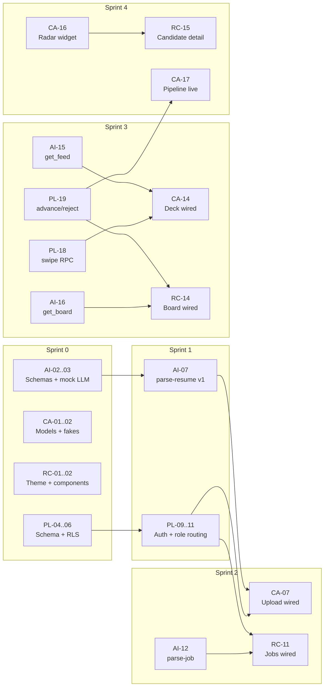

# ResuRhombus: Team Plan (4 people)

**Companion to:** [PRD.md](PRD.md) · [USER_STORIES.md](USER_STORIES.md)

**Assumptions:**
- 6 one-week sprints (Sprint 0–5). With more time, use 2-week sprints in the same order. With less, merge Sprints 4 and 5.
- **Task size:** **S** is half a day or less, **M** is about 1 day, and **L** is about 2 days. Split anything bigger before starting it.
- **Task IDs:** `PL-` is Platform, `AI-` is AI & Matching, `CA-` is Candidate app, `RC-` is Recruiter portal. Stories are referenced as `US-xx`.

---

## 1. Roles

| Person | Track | Owns | Main Claude skills |
|---|---|---|---|
| **A** | **Platform & Auth** | Supabase setup, schema and migrations, RLS, sign-up and sign-in, role routing, company onboarding backend, status transitions, seed data plumbing, CI | `resurhombus-supabase`, `resurhombus-flutter` |
| **B** | **AI & Matching** | Skill taxonomy, LLM adapter, Doc Intelligence, `parse-resume` and `parse-job`, normalization, Match Score SQL, feed and board RPCs, seed data generation | `resurhombus-matching`, `resurhombus-supabase` |
| **C** | **Candidate app** | Data models and fake repositories, upload and review, swipe deck, Radar Deep-Dive (a shared widget), pipeline | `resurhombus-ui`, `resurhombus-flutter` |
| **D** | **Recruiter portal + design system** | Theme and shared components, recruiter shell, job posting, Mosaic board, candidate detail, interview list, web build | `resurhombus-ui`, `resurhombus-flutter` |

The recruiter portal is the course deliverable, so it's deliberately spread across three people. **D** builds the screens, **A** builds company onboarding and status changes, and **B** builds `parse-job` and the board query. If one person falls behind, the deliverable doesn't stall.

Everyone owns: code reviews, their own tests, keeping `docs/PRD.md` in sync (`resurhombus-prd` skill), and the demo.

---

## 2. Strategy: agree on contracts first, then build in parallel

Your instinct is right: auth comes first, because resume uploads are stored per user and every table is protected per user. But if B waits for A to finish auth, B loses a week. Avoid that with two rules:

1. **Sprint 0 agrees on the contracts.** That means the database schema, the Dart models, the RPC and Edge Function signatures (PRD §9.6), and the AI JSON schemas. After that, everyone builds against the same agreed interfaces.
2. **Everything starts with a mock.**
   - The Flutter app has **fake repositories** (US-55), so C and D build screens with fake data from day one.
   - The AI functions start with **`LLM_PROVIDER=mock`** (US-52), and B tests `parse-resume` locally with a test user created in the local Supabase.
   - The pieces get connected at planned **integration milestones**.

### Milestones

| Milestone | End of | Demo-able result |
|---|---|---|
| **M0: Contracts frozen** | Sprint 0 | Schema migrated locally, Dart models match it, AI schemas agreed, theme in place |
| **M1: Roles work** | Sprint 1 | Anyone can sign up as a candidate or recruiter and lands on the correct home screen |
| **M2: Inputs work** | Sprint 2 | Resume → confirmed profile, and JD → published job, both with real AI |
| **M3: The loop** ⭐ | Sprint 3 | A candidate's right swipe appears on the recruiter board, sorted by Match Score |
| **M4: Loop closed** | Sprint 4 | Advance or reject updates the candidate's pipeline live. Radar and detail views done. |
| **M5: Demo-ready** | Sprint 5 | Seeded, polished, accessible, web build hosted, demo rehearsed |

### Critical dependencies

---

## 3. Sprint-by-sprint overview

| Sprint | A: Platform & Auth | B: AI & Matching | C: Candidate | D: Recruiter + Design |
|---|---|---|---|---|
| **0: Foundations** | Supabase + Flutter skeleton, GitHub board, schema migrations | Taxonomy, AI schemas, mock adapter, fake resumes and JDs | Dart models, repository interfaces + fakes | Theme tokens, core components, wireframes |
| **1: Accounts** | Sign-up trigger, auth screens, role routing, RLS tests | Doc Intelligence client, `parse-resume` v1, years and evidence logic | Upload, progress, review & confirm, preferences (fake data) | Recruiter shell, jobs list, company create/join screens |
| **2: Inputs** | Company RPCs, storage bucket, confirm profile, seed v1 | Real providers, normalization, `parse-job`, budget guard | Wire upload, progress, and review to real backend. Parse fallback. | Paste JD, requirement editor, filters, publish. Wire to backend. |
| **3: The loop** ⭐ | `swipe`/undo/cap RPCs, status transitions, tests | `compute_match`, `get_feed`, `get_board` | Job card, swipe deck, undo, pass reasons, wire to feed | Mosaic grid, blind tiles, triangle actions, wire to board |
| **4: Close the loop** | Realtime, signed resume URLs, push (stretch) | Re-score trigger, injection tests, seed generator | Radar Deep-Dive, pipeline, interview details | Candidate detail, interview list, filters, invite codes |
| **5: Polish & demo** | README, verified badge, bug fixes | Real-AI evaluation and tuning | Animated background, accessibility pass | Keyboard shortcuts, accessibility and responsive pass, host web build |

---

## 4. Task backlog

Each task should become a GitHub issue. **Dep** lists tasks that must be merged first. A task whose Dep is only a fake or mock can start right away.

### Sprint 0: Foundations (all hands, aim for M0)

| ID | Owner | Task | Size | Dep | Stories |
|---|---|---|---|---|---|
| PL-01 | A | Run `supabase init` and `supabase start` locally. Create the dev Supabase project. Commit `supabase/config.toml`. | S | — | — |
| PL-02 | A | Flutter skeleton: feature-first folders, add packages (`supabase_flutter`, `flutter_riverpod`, `go_router`, `fl_chart`, `google_fonts`, `file_picker`), add `env/example.json`, gitignore `env/dev.json` | S | — | — |
| PL-03 | A | GitHub Project board, labels (`track:*`, `size:*`, `story:US-xx`), PR template, branch protection on `master`, add `flutter analyze` to CI | S | — | — |
| PL-04 | A | Migration: `profiles`, `companies`, `recruiters`, `company_invites`, with RLS | M | PL-01 | US-01, US-30 |
| PL-05 | A | Migration: enable `vector`. Add `candidates`, `resumes`, `profile_versions`, `candidate_skills`, `skills`, `skill_relations`, with RLS. | M | PL-04 | US-07, US-09 |
| PL-06 | A | Migration: `jobs`, `job_requirements`, `swipes`, `applications`, `status_events`, `llm_usage`, with RLS | M | PL-05 | US-14, US-25 |
| AI-01 | B | Hand-curate about 300 skills (name, category, aliases) as `supabase/seed/skills.csv`, plus about 80 related-skill pairs | M | — | US-14 |
| AI-02 | B | Resume and job JSON schemas plus Zod validators in `supabase/functions/_shared/schemas.ts` | M | — | US-51 |
| AI-03 | B | `llm.ts` adapter interface, `mock` provider, and fixtures | M | AI-02 | US-52 |
| AI-04 | B | Write 10 fake resumes (PDF, varied layouts) and 6 fake job descriptions for testing and seeding | M | — | US-54 |
| CA-01 | C | Dart domain models and enums: `AppRole`, `ApplicationStatus`, `ScoreBand`, `Profile`, `Skill`, `JobCard`, `Application`, `CandidateTile` | M | PL-04..06 draft | — |
| CA-02 | C | Repository interfaces (`Auth`, `Profile`, `Resume`, `Feed`, `Application`) plus fake implementations and a provider override switch | M | CA-01 | US-55 |
| RC-01 | D | Theme tokens, `RRTheme` extension, `ThemeData` (copy from the `resurhombus-ui` skill reference) | M | PL-02 | — |
| RC-02 | D | Shared components: `RhombusMark`, `ScoreBadge`, `EmptyState`, `ShimmerShape`, plus a simple component gallery page | M | RC-01 | — |
| RC-03 | D | Repository interfaces + fakes for `Company`, `Job`, `Board` | S | CA-01 | US-55 |
| RC-04 | D | Low-fidelity wireframes for every screen (paper or Figma). Team review. | M | — | — |
| ALL-01 | All | **Contract review meeting**: walk through schema, models, RPC signatures, and AI schemas. Freeze them as M0. | S | above | — |

### Sprint 1: Accounts & skeletons (aim for M1)

| ID | Owner | Task | Size | Dep | Stories |
|---|---|---|---|---|---|
| PL-07 | A | `on auth.users insert` trigger that creates the profile from sign-up metadata. Only `candidate` or `recruiter` is allowed. | S | PL-04 | US-01, US-02 |
| PL-08 | A | `current_app_role()` helper and refactored role-based policies | S | PL-07 | US-06 |
| PL-09 | A | Real `AuthRepository`: email sign-up and sign-in, Google sign-in, sign-out, password reset | M | CA-02 | US-02, US-04, US-05 |
| PL-10 | A | Screens: Welcome, Role choice, Sign up, Sign in, Forgot password | M | RC-01, PL-09 | US-01, US-02 |
| PL-11 | A | `go_router` setup: auth refresh, role redirect, `/c/*` and `/r/*` trees, `/recruiter` pre-select | M | PL-09 | US-03, US-06 |
| PL-12 | A | pgTAP tests: profile and company RLS (own vs. other vs. anon) | M | PL-08 | US-06 |
| AI-05 | B | `azure_di.ts`: start an analysis (`prebuilt-layout`), poll until done, return lines with bounding boxes | M | — | US-07 |
| AI-06 | B | Text sanitizer: drop hidden or tiny lines, strip control characters, cap tokens. Unit tests. | S | AI-05 | US-51 |
| AI-07 | B | `parse-resume` v1: download file, run DI, sanitize, extract (mock), write `profile_versions` and skills, set statuses | L | AI-03, AI-06, PL-05 | US-07, US-08 |
| AI-08 | B | Pure functions with Deno tests: merge years per skill from role dates, evidence substring check | M | AI-02 | US-09, US-10 |
| CA-03 | C | Upload screen: pick a file, validate type and size, show errors (fake upload) | M | CA-02 | US-07 |
| CA-04 | C | `PrismUploadProgress` widget and screen driven by a fake status stream | M | RC-01 | US-08 |
| CA-05a | C | Review & Confirm: skill list with a years stepper and the edited badge | M | CA-02 | US-09 |
| CA-05b | C | Review & Confirm: remove skills, add a skill via taxonomy search, evidence sheet | M | CA-05a | US-09, US-10 |
| CA-06 | C | Preferences screen: location, remote, job type, work authorization, salary floor | M | CA-02 | US-12 |
| RC-05 | D | Recruiter shell: responsive `NavigationRail` / bottom nav, breakpoints, empty routes | M | RC-01, PL-11 stub | — |
| RC-06 | D | Jobs list screen with status chips and applicant counts (fake data) | M | RC-03 | US-38 |
| RC-07 | D | Company onboarding screens: create company form, join with code | M | RC-03 | US-30, US-32 |

### Sprint 2: Inputs end-to-end (aim for M2)

| ID | Owner | Task | Size | Dep | Stories |
|---|---|---|---|---|---|
| PL-13 | A | RPCs `create_company`, `create_invite`, `join_company`, `revoke_invite`, with tests | M | PL-04 | US-30, US-31, US-32 |
| PL-14 | A | Private `resumes` storage bucket with per-user folder policies | S | PL-07 | US-07, US-49 |
| PL-15 | A | Real `CompanyRepository` and `ProfileRepository`. Wire RC-07 to them. | M | PL-13, RC-07 | US-30, US-32 |
| PL-16 | A | `seed.sql` v1: import taxonomy, 3 companies, demo accounts for each role | M | AI-01, PL-13 | US-54 |
| PL-17 | A | RPCs `confirm_profile` and `save_preferences` | S | PL-05 | US-09, US-12 |
| AI-09 | B | `OpenAIProvider` and `AzureOpenAIProvider` in the adapter. `LLM_PROVIDER` switch. | M | AI-03 | US-53 |
| AI-10 | B | Normalization: alias lookup, then `match_skills()` vector RPC, then `unmapped` | M | AI-09, PL-05 | US-14 |
| AI-11 | B | Script to precompute taxonomy embeddings into the seed (run once, results committed) | S | AI-09, AI-01 | US-54 |
| AI-12 | B | `parse-job` Edge Function: JD → draft `job_requirements` | M | AI-09, PL-06 | US-34 |
| AI-13 | B | `llm_usage` logging and the `LLM_DAILY_TOKEN_BUDGET` guard | S | AI-09 | US-53 |
| CA-07 | C | Wire upload to Storage, invoke `parse-resume`, and drive progress from a Realtime `resumes` subscription | M | PL-14, AI-07 | US-07, US-08 |
| CA-08 | C | Wire Review & Confirm and Preferences to real data and `confirm_profile` | M | PL-17 | US-09, US-12 |
| CA-09 | C | Parse failure state and manual skill picker fallback | S | CA-07 | US-11 |
| RC-08 | D | Paste-JD screen: text area, submit to `parse-job`, progress state | M | AI-12 | US-34 |
| RC-09a | D | `RequirementEditor`: table with Required/Preferred toggle and min-years stepper | M | RC-08 | US-35 |
| RC-09b | D | `RequirementEditor`: 15/8 limits and messaging, plus JD evidence highlight | M | RC-09a | US-35 |
| RC-10 | D | Job details form: location, remote, work authorization, salary range | M | RC-03 | US-36 |
| RC-11 | D | Real `JobRepository`: create, update, publish, pause, close. Wire the jobs list. | M | PL-06, PL-11 | US-37, US-38 |

### Sprint 3: The loop ⭐ (aim for M3)

| ID | Owner | Task | Size | Dep | Stories |
|---|---|---|---|---|---|
| PL-18 | A | RPCs `swipe()` (pending application with `committed_at`, daily cap) and `undo_swipe()` | M | PL-06 | US-15, US-16, US-17, US-21 |
| PL-19 | A | RPCs `open_application`, `advance`, `reject`, `undo_reject`, `withdraw`. Validate against the state machine and write `status_events`. | M | PL-06 | US-42, US-43, US-44, US-28 |
| PL-20 | A | pgTAP tests: swipe cap, undo window, invalid transitions, recruiter can't touch other companies | M | PL-18, PL-19 | US-06, US-21 |
| AI-14 | B | `compute_match()` SQL following PRD §8.4. `breakdown` JSON for the radar. | L | AI-10 | US-14, US-23 |
| AI-15 | B | `get_feed()` RPC: hard filters, then ANN prefilter, then exact score, then Feed Rank, with a cursor | L | AI-14 | US-14 |
| AI-16 | B | `get_board()` and `get_candidate_detail()`: blind fields until interview, sorted, filterable | M | AI-14, PL-19 | US-40, US-41 |
| AI-17 | B | Scoring regression fixture (about 50 labeled pairs) and test | M | AI-14 | — |
| CA-10 | C | `JobCard` widget with drag stamps and the Invited variant | M | RC-02 | US-14 |
| CA-11 | C | `SwipeDeck`: gesture, rotation, thresholds, fling, stacked back cards, haptics | L | CA-10 | US-15, US-17 |
| CA-12 | C | `DeckActionBar` and `UndoToast` with countdown from the server's `committed_at` | M | CA-11 | US-16, US-18 |
| CA-13 | C | `PassReasonChips` (non-blocking) | S | CA-11 | US-17 |
| CA-14 | C | Wire the deck to `get_feed`, `swipe`, and `undo_swipe`. Prefetch, plus the daily cap message. | M | PL-18, AI-15 | US-14, US-15, US-21 |
| CA-15 | C | Empty deck state with actions | S | CA-11 | US-20 |
| RC-12 | D | `MosaicGrid` and blind `CandidateTile` (responsive columns, animated removal) | L | RC-02 | US-40, US-41 |
| RC-13 | D | `TriangleActions`: hover reveal, tap toggle on touch, 48 px hit areas, reject undo snackbar | M | RC-12 | US-43, US-44, US-45 |
| RC-14 | D | Wire the board to `get_board`, `advance`, and `reject`. Applicant count badges. | M | AI-16, PL-19 | US-40, US-43, US-44 |
| ALL-02 | All | **M3 integration session**: test candidate swipe → recruiter board on two devices. Fix blockers. | S | above | — |

### Sprint 4: Close the loop (aim for M4)

| ID | Owner | Task | Size | Dep | Stories |
|---|---|---|---|---|---|
| PL-21 | A | Add `applications` and `resumes` to Realtime. Verify RLS on Realtime. | S | PL-19 | US-26 |
| PL-22 | A | *(Stretch)* `notify` Edge Function + FCM setup on Android | M | PL-21 | US-27 |
| PL-23 | A | RPC that issues a signed resume URL only after advance | S | PL-14, PL-19 | US-47, US-49 |
| PL-24 | A | *(Stretch)* Account deletion: delete the candidate's data and anonymize applications | M | PL-19 | US-50 |
| AI-18 | B | Trigger that re-scores applications when `job_requirements` change | M | AI-14 | US-39 |
| AI-19 | B | Prompt-injection tests: resumes with hidden or instruction text must not affect extraction | S | AI-07 | US-51 |
| AI-20 | B | Seed generator: 30 candidates, 60 applications in every status, 150 swipes, precomputed scores, everything `is_seed` | L | AI-14, PL-16 | US-54 |
| CA-16 | C | `RadarDeepDive` shared widget: fl_chart radar, under-3-axes fallback, gap list, flip/hero | L | AI-14 breakdown | US-23, US-24 |
| CA-17 | C | Pipeline screen: `StatusChip`, timeline, Realtime updates, withdraw action | M | PL-21 | US-25, US-26, US-28 |
| CA-18 | C | Interview Requested detail with recruiter contact and note | S | CA-17 | US-29 |
| CA-19 | C | Low-match or missing-required confirmation before apply | S | CA-14 | US-19 |
| RC-15 | D | Candidate detail view (reuses `RadarDeepDive`, evidence list) that sets Under Review | M | CA-16, AI-16 | US-42 |
| RC-16 | D | Interview list with full identity and resume link | M | PL-23 | US-47 |
| RC-17 | D | Board filters (skill, minimum years) that narrow without re-ordering | M | AI-16 | US-46 |
| RC-18 | D | Company settings: generate, copy, and revoke invite codes | S | PL-13 | US-31 |

### Sprint 5: Polish & demo (aim for M5)

| ID | Owner | Task | Size | Dep | Stories |
|---|---|---|---|---|---|
| PL-25 | A | README: local setup (`supabase start`, env file, emulator URL), demo accounts section | S | PL-16 | — |
| PL-26 | A | Verified badge: compare email domain with company website | S | PL-13 | US-33 |
| AI-21 | B | Run real-AI extraction on the fake resumes. Report precision and recall. Tune the 0.88 threshold. | M | AI-10 | — |
| CA-20 | C | `GeometricBackground` with reduced-motion and lifecycle pause | M | RC-01 | — |
| CA-21 | C | Candidate accessibility pass: TalkBack actions, 2.0× text scale, contrast, 60 fps profile | M | all CA | US-18 |
| RC-19 | D | *(Stretch)* Keyboard shortcuts J/K/A/R and a help dialog | M | RC-14 | US-48 |
| RC-20 | D | Recruiter accessibility and responsive pass at 360 px and 1280 px | M | all RC | US-45 |
| RC-21 | D | Build Flutter Web (`flutter build web`) and host it on a static host | S | RC-20 | — |
| ALL-03 | All | Bug bash: everyone tests the other tracks' flows for 1 hour and files issues | S | — | — |
| ALL-04 | All | Demo script and 2 dry runs (candidate on Android, recruiter on web, side by side) | S | ALL-03 | — |

---

## 5. Working agreements

**Board:** GitHub Projects with columns *Backlog → Sprint → In progress → In review → Done*. One issue per task ID. Each issue links its `US-xx` stories.

**Branches and PRs**
- Branch per task: `feat/<ID>-short-name` (e.g., `feat/CA-11-swipe-deck`).
- Keep PRs small (under about 400 changed lines). Each needs **1 approving review** and **green CI** before it's squash-merged into `master`.
- The reviewer is ideally from a track that depends on the work, e.g., C reviews PL-18 because the deck uses it.

**Migrations (avoid conflicts):**
- **A merges all migrations.** Others may write a migration on their branch, but they post in the team chat first and rebase onto the newest migration before merging.
- Never edit a merged migration. Write a new one instead.

**Secrets:**
- The `env/dev.json` and `supabase/functions/.env` files are shared privately (e.g., a password manager or private message), **never committed**.
- The app only ever contains the anon key.

**Rhythm**
- **Async standup** daily in chat: yesterday, today, blockers.
- **Sprint planning** (30 min) at the start of each week: pull tasks into the Sprint column.
- **Integration and demo** (45 min) at the end of each week: merge to `master`, demo the milestone on a real device and the web, and pick next week's tasks.

**Definition of Done (per task)**
1. Its "Done when" criteria from USER_STORIES.md pass.
2. Tests are added: unit or widget tests for Flutter, pgTAP for SQL, Deno tests for Edge Functions.
3. `flutter analyze` is clean and CI is green.
4. All four UI states (loading, empty, error, content) are handled for screens.
5. The PRD is updated if a contract changed.

**When blocked:** If a task you depend on isn't merged, keep building against the fake or mock and flag it at standup. Never wait idle.

---

## 6. Risks & mitigations

| Risk | Mitigation |
|---|---|
| Real backend arrives late and UI tracks stall | Fake repositories (CA-02, RC-03) and mock LLM (AI-03) from Sprint 0 |
| Schema churn breaks everyone | M0 contract freeze. Changes after M0 need a short team chat announcement plus a PRD update. |
| Swipe deck animation takes longer than planned (CA-11) | Timebox to 2 days. Fall back to `flutter_card_swiper` and keep the visual polish for Sprint 5. |
| AI parsing is slow or flaky during the demo | Seed data covers the board without live parsing. Cache results by file hash. Rehearse with a resume parsed beforehand. |
| API credits run out | `mock` provider for development, daily token budget guard, precomputed embeddings in the seed |
| Recruiter deliverable incomplete | It's spread across A, B, and D. M3 ⭐ is the must-hit milestone. Stretch tasks are clearly marked and can be cut. |
